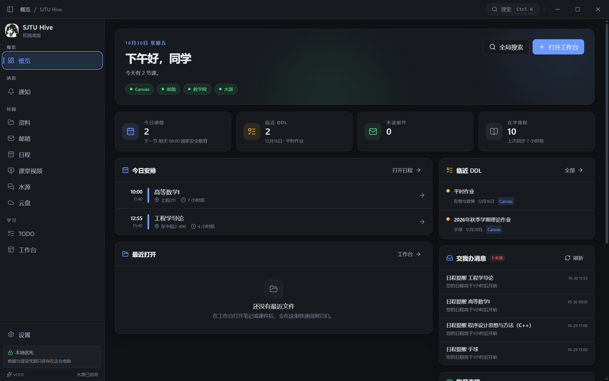
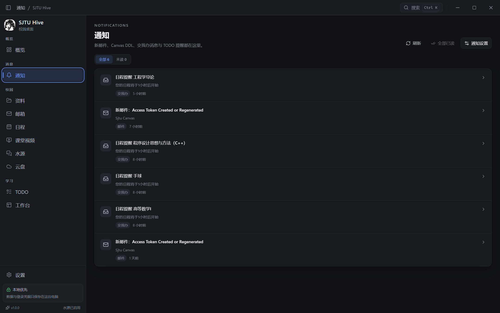

# SJTU Hive · 校园桌面

面向上海交大学生的本地优先校园桌面，使用 **Wails v2 + Go + React** 独立实现。它覆盖 Dela 除 Agent 以外的校园功能：Canvas 资料、校园邮箱、交我办日程、课堂视频、水源社区、TODO、全局搜索，以及本地的笔记/文件工作台与终端。

> 本应用是参考 Dela 行为与交大公开接口的独立实现，**没有复制 Dela 的源码或界面素材**，与上海交通大学、Dela 作者均无隶属关系。



## 功能

| 模块 | 能力 |
| --- | --- |
| 概览 | 今日课程、临近 DDL、未读邮件、账号状态、最近文件、快捷操作 |
| 资料 / Canvas | Personal Access Token；课程/学期/文件树/模块/作业/页面/讨论同步；PDF、图片、文本、Markdown、HTML、DOCX、XLSX 预览；下载、批量导出、添加到本地项目；PPTX/旧版 Office 调用系统 Office 打开 |
| 邮箱 | 交大邮箱预设或第三方 IMAP/SMTP；文件夹与未读计数；摘要优先同步、正文按需获取；附件；写信、回复、转发；本地草稿自动保存；本地回收站 |
| 云盘 | 交大云盘 pan.sjtu.edu.cn（腾讯 coFile）：jAccount 单点登录、目录浏览、流式预览与下载、配额显示 |
| 消息 | 交我办站内消息（my.sjtu.edu.cn /api/jwbmessage）：每 10 分钟同步未读，进入通知页并投递系统通知 |
| 通知 | 独立通知页（侧栏「消息 / 通知」）：全部/未读筛选、全部已读、按来源跳转；Windows 通知 |
| 考试 | 教学网学生考试查询：学期同步、周/月视图图层、侧栏考试安排卡片与考前 36 小时提醒 |
| 日程 | 交我办日历（my.sjtu）课程、考试、会议、讲座与个人日程；教学网登录后自动 SSO；每小时同步；默认周视图，可切换月视图；本地日程新建/编辑 |
| 课堂视频 | 学期/课程/录像列表；单画面与双画面（两路整宽 16:9 完整显示，区域不足时滚动）；播放代理；语音文稿跟随与点击跳转；导出 TXT；断点续看；本地下载（试验开关） |
| 水源 | Discourse User API Key 授权；最新/精品/分类/标签/搜索；主题与楼层；回复、发主题、私信；点赞；收藏；通知；图片上传；用户主页（自己与他人）与徽章；secure uploads 图片本地代理 |
| TODO | 本地待办 + Canvas 作业 DDL 聚合；完成状态；列表/月历；写入月历并双向联动；到期提醒 |
| 全局搜索 | 课程资料、邮件、日程、TODO、水源、项目文件、设置项的本地搜索 |
| 工作台 | 本地项目、文件树、标签页、CodeMirror 文本编辑、Markdown + KaTeX + mermaid、PDF/图片/DOCX/XLSX 预览、内置 ConPTY 终端（Git Bash 优先，PowerShell 兜底）、Git 分支显示与切换 |
| 设置 | 账户与连接、主题/字号（默认跟随系统，可按基准 70%–180% 调节）/缩放、开机自启、关闭行为（托盘/退出）、系统通知测试、通知、试验功能、导航入口、缓存、备份、手动检查更新、条款与隐私 |
| 托盘 | 自研 Win32 通知区图标：左键恢复窗口、右键菜单「打开主界面 / 退出 SJTU Hive」，关闭按钮可按设置隐藏到托盘 |
| 会话续期 | 校园 Cookie 失效时自动用 jAccount 单点登录静默续期（教学网两跳 SSO），续期失败才提示重新登录 |

Agent 相关能力（聊天、会话、Pi、skills、MCP、模型供应商、packages、web_search/web_fetch、远程项目/SSH、文件变更审阅）**全部不包含**。

## 截图



## 安装与运行

安装包与绿色版位于 `build/bin/`：

- `SJTU-Hive.exe`：绿色版，双击运行。
- `SJTU Hive-amd64-installer.exe`：用户级 NSIS 安装包，不要求管理员权限；安装到 `%LOCALAPPDATA%\Programs\SJTU Hive`。

系统要求：Windows 10/11 x64、WebView2 Runtime（安装包会检查；绿色版需系统已安装）。首次启动会显示条款与账户配置引导。

### 首次配置

1. **Canvas**：`oc.sjtu.edu.cn` → 账户 → 设置 → 新建访问令牌，复制后粘贴到「设置 → 账户与连接」或资料页的「连接」。
2. **校园邮箱**：填写邮箱地址与密码/授权码；交大邮箱默认 `mail.sjtu.edu.cn` IMAP 993 / SMTP 465。第三方邮箱可展开自定义服务器。
3. **教学信息服务网 / 课堂视频**：点击登录，应用会打开独立 Edge 配置文件窗口；登录成功后自动读取 `.sjtu.edu.cn` Cookie 并加密保存。登录窗口打不开时，可从浏览器开发者工具复制 Cookie 请求头粘贴。
4. **水源**：点击「登录并授权」，在打开的授权页登录并确认，然后复制页面展示的加密密文粘贴回应用绑定。

## 数据与安全

- 所有数据保存在本机，不上传服务器；没有应用账号系统。
- 凭据（Canvas Token、邮箱密码、校园 Cookie、水源 Key）使用 **Windows DPAPI** 加密，前端无法读取明文。
- SQLite：`%APPDATA%\SJTU Hive\sjtu.db`；加密凭据：`%APPDATA%\SJTU Hive\secrets\`；日志：`%APPDATA%\SJTU Hive\logs\`。
- 缓存：`%LOCALAPPDATA%\SJTU Hive\cache\`；WebView2：`%LOCALAPPDATA%\SJTU Hive\EBWebView\`；Edge 校园登录配置：`%LOCALAPPDATA%\SJTU Hive\edge-campus\`。
- 默认项目目录：`文档\SJTU Notes`（首次启动自动创建，可移除登记，不会删除磁盘文件）。
- 邮件与水源 HTML 在沙箱 iframe / DOMPurify 后渲染；外部链接交给系统浏览器打开。
- 下载/预览资源通过本机 `127.0.0.1` 随机端口 + 随机能力令牌提供，课堂视频使用代理转发，Cookie 不暴露给渲染层。

## 开发

```sh
# 前置：Go 1.25+、Wails v2.16、Node 24+、NSIS（打包）
export GOPROXY=https://goproxy.cn,direct
export GOSUMDB=off GOTOOLCHAIN=local

go run github.com/wailsapp/wails/v2/cmd/wails@v2.16.0 build -platform windows/amd64
go run github.com/wailsapp/wails/v2/cmd/wails@v2.16.0 build -platform windows/amd64 -nsis -installscope user -webview2 download
go test ./... -count=1
```

前端可单独在浏览器中预览（不依赖 Wails）：`cd frontend && npm install && npm run dev`。当 `window.go` 不存在时，`src/lib/mock.ts` 会提供演示数据；Wails 中始终走真实 Go 服务。

架构说明见 [docs/design.md](docs/design.md)。

## Android

`android/` 是配套的 Android 应用（Kotlin + Jetpack Compose，minSdk 33），提供概览、日程、消息、云盘、课堂视频（自动横屏、玻璃控件、单/双画面）、水源与设置。

```sh
cd android
gradle :app:assembleDebug   # 或 :app:assembleRelease（需本地 keystore.properties）
```

Release 中的 APK 为维护者本地正式签名；`android/keystore.properties` 与 `android/keystore/` 不入库。

## 已知限制

- 交我办消息与云盘依赖 jAccount 会话：会话过期时应用会先静默续期，jAccount 本身过期后才需要重新登录；云盘 `user_token` 有效期 30 天，`access_token` 30 分钟自动续取。
- 日程来自交我办日历，本地日程不写回学校系统。
- 单标签组（无分屏）、固定快捷键（无自定义键位）、无静默自动更新；PPTX/旧版 Office 走系统 Office。
- 水源为 beta，接口可能随站点调整；邮箱一次配置一个账户。
- 课堂视频「全量缓存」以本地下载实现；未做转码/合并；已开始传输的流中断后由播放器重试。
- 自动更新只做「检查更新 + 打开下载地址」，不自动下载或安装。

## 许可

本项目源码以 MIT License 发布（见 `LICENSE`）。使用的第三方库与素材许可见 [THIRD_PARTY_NOTICES.md](THIRD_PARTY_NOTICES.md)。
